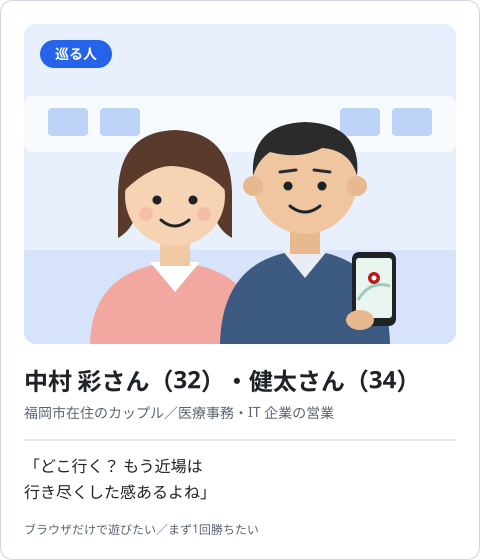
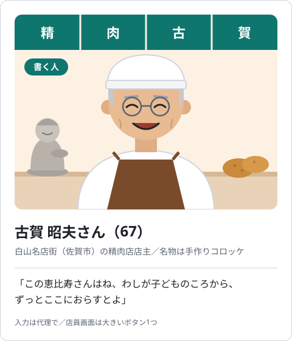
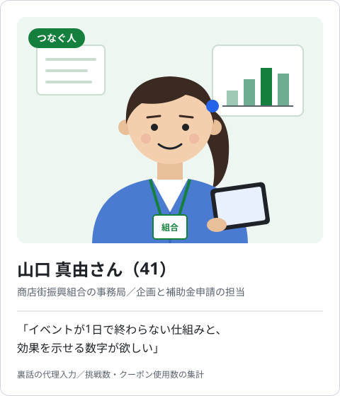

# ペルソナ

発表で軸にするのは「巡る人」と「書く人」の2人です。クーポンを扱うので、商店街側の窓口役を1人加えています。

名前や細かい設定はすべて架空です。発表に使う前に、チームに佐賀の人がいれば方言や商店街の雰囲気を確認してもらうと、リアリティが上がります。

---

## ペルソナ1：巡る人（メイン）

### 中村 彩さん（32）・健太さん（34）／福岡市在住のカップル



| 項目 | 内容 |
| --- | --- |
| 仕事 | 彩：医療事務、健太：IT 企業の営業 |
| 住まい | 福岡市中央区。車なし、移動は電車が中心 |
| 休日 | 月2回くらい、近場へ日帰りで出かける。糸島、太宰府、柳川はもう行った |
| スマホ | 行き先はインスタと Google マップで探す。アプリを入れるのは面倒なので、ブラウザで済むなら嬉しい |
| 佐賀の印象 | 「特急で40分くらいだけど、何があるかよく知らない」。バルーンフェスタに一度行ったきり |

**目的**

- 人が多すぎず、ちょっと珍しいところで休日を過ごしたい
- 写真に残せる体験と、おいしいものが欲しい

**不満**

- 観光地を調べても、ネットで見たことのある写真ばかり出てくる
- 1か所見たら終わってしまい、半日でやることがなくなる

**口ぐせ**

> 「どこ行く？ もう近場は行き尽くした感あるよね」

**アプリを使う流れ**

1. 健太さんが SNS で「佐賀の恵比寿さんに挑むゲーム」を見かける
2. 土曜の昼に佐賀駅に着き、ブラウザでアプリを開く。地図に恵比寿さんが並んでいる
3. 1体目に近づき、お題「わしの向かいの店の名物は？」に挑む。分からないので、店をのぞいて正解する
4. 裏話「この恵比寿さんは昭和の大火のあと、商店街のみんなで…」が解放される
5. 「福クーポン：コロッケ1個おまけ」をもらい、その店で使う
6. 気づくと5体回っていて、夕方まで佐賀にいた

**やめてしまう原因**

- 最初の1体が遠い、または見つからない
- アプリのインストールや会員登録を求められる
- お題が難しすぎて、現地でも答えが分からない

**設計への示唆**

- 登録なしで、ブラウザだけで遊べるようにする
- 駅の近くに「最初の1体」を置き、まず1回勝つ体験をさせる
- お題は「現地で周りを見れば分かる」難しさにする

---

## ペルソナ2：書く人・お店の人

### 古賀 昭夫さん（67）／白山名店街の精肉店店主



| 項目 | 内容 |
| --- | --- |
| 仕事 | 佐賀市中心部の白山名店街で、父の代から続く精肉店。名物は手作りコロッケ |
| 住まい | 店の2階。白山名店街に60年以上いる |
| 店の前 | 恵比寿さんが1体ある。毎朝、水をかえて手を合わせている |
| スマホ | LINE と電話は使う。文字入力は遅く、長い文章は打たない |
| 家族 | 娘さんが市内に住み、週末に店を手伝う |

**目的**

- 店を続けたい。新しいお客さんに来てほしい
- 恵比寿さんにまつわる昔の話を、誰かに伝えたい

**不満**

- 人通りが減り、平日はほぼ常連さんだけ
- 昔の話を聞いてくれる若い人がいない
- ネットで宣伝しろと言われても、どうすればいいか分からない

**口ぐせ**

> 「この恵比寿さんはね、わしが子どものころから、ずっとここにおらすとよ」

**アプリとの関わり方**

1. 商店街の集まりで、窓口役（ペルソナ3）から説明を受ける
2. 自分では入力しない。窓口役か娘さんに昔の話を話し、それを代わりに書いてもらう
3. 店で出すクーポンは「コロッケ1個おまけ」に決める。原価が安く、気軽に出せる
4. お客さんがスマホを見せてきたら、「使用済み」ボタンを1回押すだけ
5. 「恵比寿さんの話、読みましたよ」と言われて、つい話し込む

**やめてしまう原因**

- 操作が多い、または画面の文字が小さい
- クーポンの扱いが面倒で、店が忙しいときに手間になる
- 恵比寿さんが雑に扱われている（茶化した表現など）と感じる

**設計への示唆**

- 店員側の画面は大きいボタン1つにする
- 裏話の投稿は、本人ではなく代理で入力できるようにする
- 恵比寿さんを「倒す」敵にせず、敬意のある表現にする

---

## ペルソナ3：つなぐ人（商店街の窓口）

### 山口 真由さん（41）／商店街振興組合の事務局



| 項目 | 内容 |
| --- | --- |
| 仕事 | 組合の事務局で、イベントの企画や補助金の申請を担当 |
| 住まい | 佐賀市内。子どもが小学生 |
| スマホ | 普通に使える。組合の Instagram も更新している |

**目的**

- 商店街に新しい人を呼ぶ企画を出したい
- 市や組合に「効果があった」と数字で報告したい

**不満**

- イベントをやっても1日で終わり、続かない
- 来場者数くらいしか効果を測れない

**アプリとの関わり方**

- お店にクーポンの参加をお願いし、店主の話を聞いて裏話を入力する
- 管理画面で「どの恵比寿さんが何人に挑まれたか」「クーポンが何枚使われたか」を見る
- その数字を、来年の補助金申請の資料に使う

**設計への示唆**

- 集計を見られる画面がいる（デモでは簡単なグラフ1枚で十分）
- 地元の人を巻き込むのはこの人。発表で「続けられる理由」を聞かれたときの答えになる

---

## 3人の関係

```
古賀さん（話を持っている）
   │ 話す
   ▼
山口さん（入力してアプリに載せる） ──→ 数字を市や組合に報告
   │
   ▼
アプリ（恵比寿さん × お題 × 裏話 × クーポン）
   │ 挑む・読む・使う
   ▼
中村さんカップル（巡って、店でお金を使う）──→ 古賀さんの店へ
```

発表では、次の1シーンで全体を伝える。

> 福岡から来たカップルが、白山名店街の店主しか知らない恵比寿さんの話を読んで、その店でコロッケを買う

## サブのペルソナ（今回は外した）

話がぼやけないよう、次の2人は発表の軸から外しています。機能を足すときの参考にしてください。

- **佐賀市内の小学生の親子**：近所の散歩が「集める遊び」になる。図鑑を埋める要素が刺さる
- **佐賀出身・佐賀在住の20代**：「佐賀って何もない」と言われるのが悔しい。裏話の投稿数を増やす役

## 運用するときに確認すること

- クーポンを「買い物をした人だけ」に出す形にすると、景品表示法で景品の金額に上限がかかる場合がある。実際に運用する前に確認する
- 位置情報は偽装できる。「1人1店1回まで」「店員さんが使用済みにする」で、まずは防ぐ
